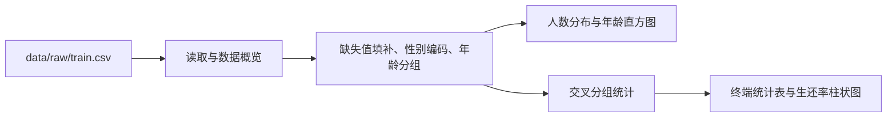

# 泰坦尼克号生存特征分析

> 使用 pandas 和 Matplotlib 探索泰坦尼克号乘客的生还情况，比较性别、客舱等级和年龄组之间的生还率差异。

## 项目简介

项目从原始乘客数据出发，依次完成数据概览、缺失值处理、分组统计和可视化。运行 `main.py` 即可在终端查看统计表，并打开 9 张分析图。

| 功能 | 说明 |
| --- | --- |
| 数据概览 | 显示前 5 行、字段类型、数值列描述统计和各列缺失值 |
| 数据预处理 | 登船港口缺失值填为 `S`，年龄缺失值用样本平均年龄填补，性别编码为女性 `0`、男性 `1` |
| 年龄分组 | 保留数值年龄，新增 `Age_Level`，分为 ≤18 岁、超过 18 岁至 40 岁（含）和超过 40 岁 |
| 分组统计 | 按性别 × 客舱等级、年龄组 × 性别、年龄组 × 客舱等级统计乘客数、生还人数和生还率 |
| 可视化 | 用人数柱状图、年龄直方图和分组生还率柱状图展示结果 |

## 数据说明

[原始数据](data/raw/train.csv)包含 891 条乘客记录和 12 个字段。生还率按该组生还人数除以该组乘客人数计算。

| 字段 | 含义 |
| --- | --- |
| `Survived` | 生还状态，`1` 表示生还，`0` 表示未生还 |
| `Sex` | 乘客性别 |
| `Pclass` | 客舱等级，取值为 1、2、3 |
| `Age` | 年龄，单位为岁 |
| `Embarked` | 登船港口 |

## 处理流程



## 快速开始

已在 Python 3.13.5、pandas 2.2.3 和 Matplotlib 3.10.0 下验证。以下为 Windows PowerShell 命令。

```powershell
git clone https://github.com/Qian-Bo-Han/titanic-survival-eda.git
cd titanic-survival-eda
python -m venv .venv
.\.venv\Scripts\python.exe -m pip install pandas==2.2.3 matplotlib==3.10.0
.\.venv\Scripts\python.exe main.py
```

也可以在 PyCharm 中选择该虚拟环境，直接运行 `main.py`。入口按项目目录定位数据。统计结果打印到终端，图表通过 Matplotlib 窗口显示，默认无图表文件输出。

## 目录结构

```text
titanic-survival-eda/
├── .gitignore
├── README.md
├── main.py                      # 运行入口
├── data/
│   └── raw/
│       └── train.csv            # 原始乘客数据
└── src/
    └── titanic_eda/
        ├── __init__.py
        ├── preprocessing.py     # 缺失值处理与特征转换
        ├── analysis.py          # 分组统计与绘图
        └── pipeline.py          # 数据读取和流程编排
```

## 样本结果与局限

| 分组 | 乘客数 | 生还人数 | 生还率 |
| --- | ---: | ---: | ---: |
| 全样本 | 891 | 342 | 38.38% |
| 女性 | 314 | 233 | 74.20% |
| 男性 | 577 | 109 | 18.89% |
| 一等舱 | 216 | 136 | 62.96% |
| 二等舱 | 184 | 87 | 47.28% |
| 三等舱 | 491 | 119 | 24.24% |

上述差异是样本中的描述性结果，单变量比例受各组乘客构成影响。177 条缺失年龄记录均使用样本平均年龄填补，解读年龄组结果时应考虑填补对各组人数和生还率的影响。
